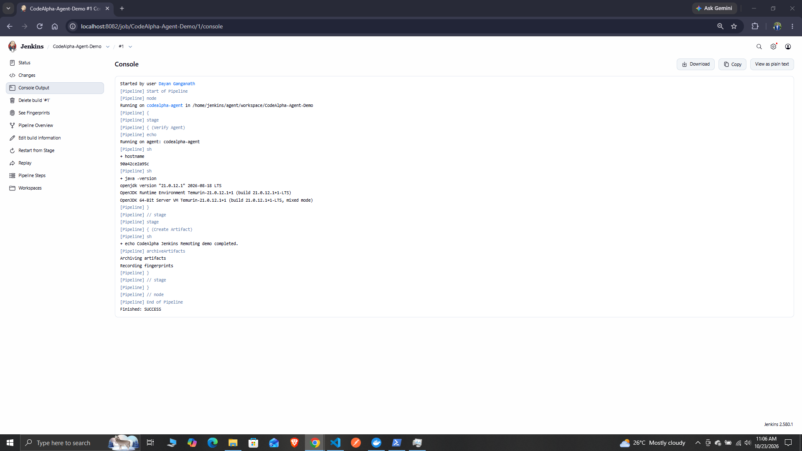

# CodeAlpha Jenkins Remoting

A Jenkins controller and a separate Docker agent connected through WebSocket.

## Tools

- Docker Desktop
- Jenkins LTS
- Java 21
- Jenkins Pipeline

## Configuration

- Controller URL: http://localhost:8082
- Controller container: codealpha-jenkins
- Agent container: codealpha-agent
- Docker network: codealpha-jenkins
- Agent label: codealpha-linux
- Agent workspace: /home/jenkins/agent

## Run the pipeline

1. Create a Pipeline job named CodeAlpha-Agent-Demo.
2. Paste the Jenkinsfile contents into the Pipeline script field.
3. Enable Use Groovy Sandbox.
4. Save and select Build Now.

## Verified result

- Pipeline executed on codealpha-agent.
- Java 21 ran successfully.
- result.txt was archived and fingerprinted.
- Build finished with SUCCESS.

## Restart

Run these commands in PowerShell:

    docker start codealpha-jenkins
    docker start codealpha-agent

## Evidence

Keep Jenkins passwords and agent secrets private.
